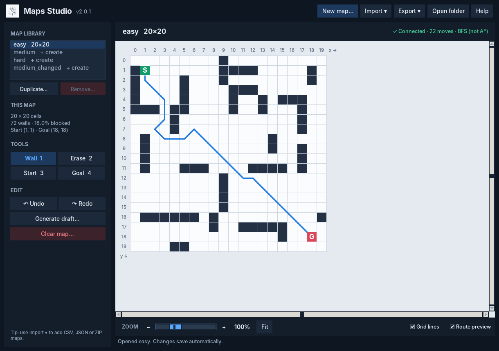
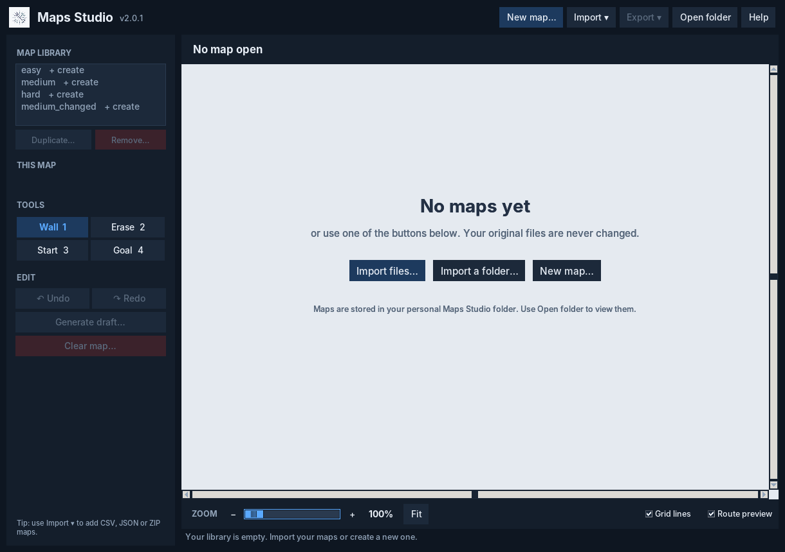

# Maps Studio


A free, open-source desktop app for drawing, generating, importing and sharing grid maps for
route-planning experiments. Originally created as an AI-assisted preparation utility for a COMP1827 swarm-intelligence group project. Maps are
plain CSV + JSON files, so any algorithm can read them.



## Download

**Publishing through the GitHub website?** Follow the [step-by-step web-only upload guide](docs/GITHUB_UPLOAD_GUIDE.md).

Go to the [Releases](../../releases/latest) page and download the file for your computer:

| Your computer | File | How to start it |
|---|---|---|
| Windows 10/11 | `MapsStudio-Windows-x64.zip` | Extract the ZIP, then double-click `MapsStudio.exe` |
| Ubuntu / Kubuntu 22.04 or newer | `maps-studio_2.0.1_all.deb` | `sudo apt install ./maps-studio_2.0.1_all.deb`, then open **Maps Studio** from the menu |
| Other Linux (x64) | `MapsStudio-Linux-x64.tar.gz` | `tar -xzf` it, then run `./MapsStudio/MapsStudio` |

You do not need Python for the Windows or portable Linux downloads. The `.deb` uses your system's
Python and installs `python3-tk` automatically.

The Windows program is not code-signed. Windows may show a SmartScreen warning. Only run software you trust; verify that the download came from the intended GitHub repository and compare its checksum.
`SHA256SUMS.txt` on each release lets you check the files.

> **Release status:** The 2.0.1 source and Linux tests were verified in the audit environment.
> Windows CI is configured but must pass in your own GitHub Actions run before declaring a 2.0.1 Windows release tested.
> An earlier 2.0.0 Windows binary was smoke-tested under Wine; that is not a substitute for a native Windows test.

## First start: an empty library

Maps Studio starts with no maps. Add yours in any of these ways:

- **Drag and drop** your `.csv` files (with their `.json` files), a `.zip`, or a whole folder onto the window.
- **Import ▾ → CSV, JSON or ZIP files…** or **Import ▾ → A whole folder…**
- **New map…** to start an empty map or generate a draft.

Importing only reads your files. They are copied into Maps Studio's own maps folder, and that copy
is what you edit.




> **Migration note:** This rebrand uses a separate `Maps Studio` data folder. Existing MP or COMP1827 Map Studio maps are unchanged. Use **Import → A whole folder** to copy any existing maps into Maps Studio.

## What it does

- **Edit**: walls, erase, Start and Goal (keys 1–4; right-click erases), drag to paint, undo/redo,
  zoom and fit. Every edit is saved straight away.
- **Import by drag and drop**: drop CSV, JSON or ZIP files, or a whole folder, onto the window.
  You see every map, its size and any problem before anything is written. Excel CSVs (semicolons,
  tabs, BOM) and CSVs without a JSON file are accepted.
- **New maps**: any name, any size from 3×3 to 200×200, empty or a generated draft.
- **Draft generator**: scattered cells, wall segments, or rooms and doors. The same seed always
  gives the same map, and Start is always connected to Goal.
- **Export**: one map to a folder, or several maps as one ZIP. Existing files are never replaced
  without asking, and replaced files are kept as `.backup-…` copies.
- **Medium Changed**: an add-only copy of Medium for the dynamic test (see below).
- **Connectivity preview**: shows whether Start and Goal are connected.

Screenshots below show a generated demonstration map; no project map files are bundled.

## Map files

```
easy.csv    one row per line, 0 = free, 1 = wall, no header. A cell is grid[y][x].
easy.json   {"width": 20, "height": 20, "start": [19.5, 0.5], "goal": [0.5, 19.5]}
```

Start and Goal are stored as **cell centres**: cell (x, y) is written as `[x + 0.5, y + 0.5]`.
The coursework names keep their agreed sizes: `easy` 20×20, `medium` and `medium_changed` 40×40,
`hard` 60×60. Any other name can be any size.

## Where your maps are kept

| System | Folder |
|---|---|
| Windows | `%LOCALAPPDATA%\Maps Studio\grids` |
| Linux | `~/.local/share/Maps Studio/grids` |

**Open folder** in the app opens it in Explorer (Windows) or your file manager (Linux). If no file
manager can be started, the app shows the path with a **Copy path** button. **Help (F1)** also
shows the path. Updating the app never touches this folder.

How your data is protected:

- **Saving** writes both files through temporary files and keeps the previous pair plus a small
  journal until the new files are checked. If the app or computer stops half-way, the next time
  the map opens it is rolled back to the last complete version.
- **Backups**: before the first save of each session, a copy goes into `.maps_studio/backups/<map>/`
  (the last 20 are kept).
- **Import** only reads the original files. Everything is checked before anything is written.
- **Removed** maps go to `.maps_studio/trash/`. The four coursework maps cannot be removed.
- **Two windows**: if Maps Studio is already open, a second window opens read-only.

## Medium Changed

Choose `medium_changed` in the library to create it as an exact copy of Medium. It is
**add-only**: you can add walls (shown in orange) and remove the ones you added, but Medium's
walls, Start and Goal are locked. The app remembers the exact Medium it was copied from and warns
you if Medium is edited afterwards. Where the new obstacle goes is your decision, based on your
own optimum route. The app does not choose it.

## About the route preview

The blue line is a breadth-first search over the 8 neighbouring cells with no diagonal corner
cutting. It proves that Start and Goal are connected and counts **grid moves** (a diagonal counts
as one). It is **not** A*, not the shortest distance, not the continuous optimum and not the
group's evaluator.

## Run from source

Python 3.10 or newer with Tkinter (`sudo apt install python3-tk` on Ubuntu; the python.org
installer on Windows includes it).

```bash
python3 -m pip install -r requirements.txt   # optional: enables drag and drop
python3 MapsStudio.py                        # or ./run-from-source.sh, or run-from-source.bat
```

Options: `--data-dir PATH` uses a different maps folder; `--smoke-test` opens the maps, makes and
undoes one edit, then exits (used by CI).

## Test

```bash
python3 -m pip install -r requirements-dev.txt
python3 -m pytest -q            # on a Linux machine with no screen: xvfb-run -a python3 -m pytest -q
```

The tests cover the empty first start, importing coursework-sized maps (CSV bytes kept exactly),
the CSV/JSON rules, the connectivity preview against hand-worked examples, the generators, crash
recovery, import, export, Medium Changed, Open folder and the window itself.

## Build

| Output | Command |
|---|---|
| Windows `.exe` (on Windows) | `build-windows.bat` |
| Linux binary (on Linux) | `./build-linux.sh` |
| Ubuntu `.deb` (on Linux) | `packaging/linux/build-deb.sh` |

Each platform must be built on that platform. GitHub Actions does both for you; see
[RELEASING.md](RELEASING.md).

## Project layout

```
maps_studio/core.py      map rules, validation, preview, generators, editing rules (no files, no UI)
maps_studio/storage.py   loading, crash-safe saving, backups, import, export, single-window lock
maps_studio/ui.py        the Tkinter window and dialogs
maps_studio/dnd.py       optional drag and drop (tkinterdnd2)
maps_studio/app.py       start-up and command-line options
tests/                 core, storage and interface tests
packaging/linux/       .deb builder
.github/workflows/     tests on every push; builds and releases on version tags
```

## Where it has been tested

| Platform | What was checked |
|---|---|
| Linux with a virtual desktop display | **78 automated tests and 3 parameterised cases passed** after the Maps Studio rename; `python MapsStudio.py --smoke-test` passed; the new logo rendered in the Maps Studio GUI screenshot. |
| Native Windows `.exe` | The GitHub Actions workflow is configured to build and smoke-test `MapsStudio.exe` on a Windows runner. **Not yet run/verified for the renamed application.** |
| Native Linux executable / `.deb` | GitHub Actions is configured to build both branded Maps Studio downloads. **Not yet built/verified for this rebrand.** |

## Known limitations

- The Windows `.exe` is not code-signed, so SmartScreen warns the first time.
  Some antivirus programs also flag one-file PyInstaller programs by mistake; the SHA-256 checksums on
  the release page let anyone confirm the file is the one GitHub built.
- macOS is not packaged or tested.
- Drag and drop relies on the bundled `tkinterdnd2` package. If it cannot load on a system,
  the app still works and the Import menu does the same job.
- The portable Linux binary is built on Ubuntu 22.04 and needs a distribution at least that new.
- Saving a CSV + JSON pair is recoverable, not truly atomic: after a crash the pair is repaired
  the next time that map is opened.
- The single-window lock covers one computer's maps folder. It does not coordinate people editing
  copies of the same map on different computers. Agree changes to shared maps as a team.

## AI assistance and academic integrity

Maps Studio was developed with AI assistance (ChatGPT and Claude) as a **preparation tool** for a
group project. It contains no assessed coursework: no A*, no Ant Colony Optimisation, PSO, ABC or
DFO, no optimum calculation and no experiment results. It ships with no maps; the team's maps are
kept separately and imported by each user. The University of Greenwich's rules on AI use for
COMP1827 apply to anything submitted.

## Licence

MIT, see [LICENSE](LICENSE). Bundled third-party components are listed in
[THIRD_PARTY_NOTICES.md](THIRD_PARTY_NOTICES.md). Contributions are welcome; see
[CONTRIBUTING.md](CONTRIBUTING.md).

## Publishing the project

See [GITHUB_UPLOAD_GUIDE.md](docs/GITHUB_UPLOAD_GUIDE.md) for GitHub upload commands and release steps.
See [QA_REPORT.md](docs/QA_REPORT.md) for the audit results and limits of verification.
